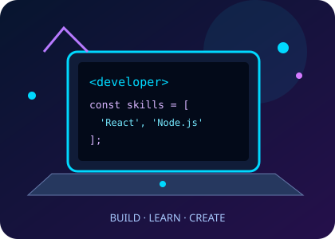
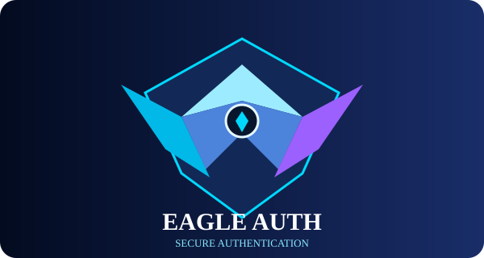
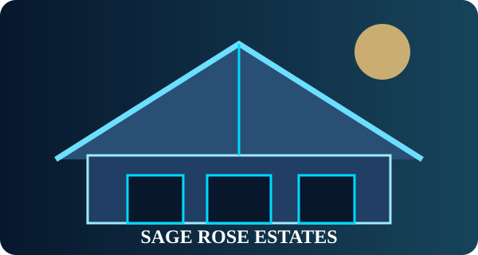
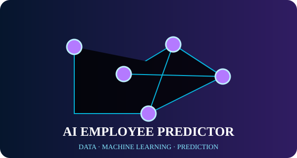
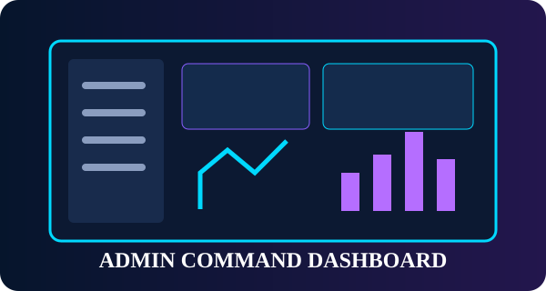

<!-- =====================================================
 ASWINI MEDISETTI | PREMIUM GITHUB PROFILE
 USERNAME: Aswinimedisetti28
 THEME: MIDNIGHT NAVY + ELECTRIC BLUE + CYAN + VIOLET
===================================================== -->

<!-- ================= TOP NAVIGATION ================= -->

[</> Projects](#-featured-projects) ·
[▤ Skills](#-technology-universe) ·
[▣ Learning](#-learning-journey) ·
[↗ Stats](#-github-statistics) ·
[⚙ Services](#-developer-services) ·
[✉ Connect](#-connect-with-me)

---

<!-- ================= HERO SECTION ================= -->

<table>
<tr>
<td width="23%" align="center" valign="middle">

</td>

<td width="49%" valign="middle" align="center">

HI, I'M

# ASWINI DEVI MEDISETTI

### Aspiring Full-Stack MERN Stack Developer

**A Curious Learner | Problem Solver | Project Builder | Tech Enthusiast**

</td>

<td width="28%" align="center" valign="middle">

</td>
</tr>
</table>

---

<!-- ================= ABOUT / MISSION / FOCUS ================= -->

<table>
<tr>
<td width="34%" valign="top">

## 👩‍💻 About Me

I'm a passionate and self-motivated developer who loves learning new technologies, building real-world projects, and solving problems.

I'm focused on becoming a skilled Full-Stack Developer while exploring AI, ML, Data Analytics, and Cloud technologies.

</td>

<td width="33%" valign="top" align="center">

## 🎯 Developer Mission

*To continuously learn, build, and create impactful technology solutions that solve real-world problems and contribute to the developer community.*

</td>

<td width="33%" valign="top">

## ⚡ Current Focus

- [x] MERN Stack – Building projects
- [x] DSA – Problem-solving practice
- [x] AI/ML – Learning and experimenting
- [ ] Cloud – Basics to deployment
- [ ] DevOps – Engineering foundations
- [ ] Professional developer portfolio

</td>
</tr>
</table>

---

<!-- ================= TECHNOLOGY UNIVERSE ================= -->

# 🧬 Technology Universe

###  Programming Languages, Frameworks, Platforms and Tools

<table>
<tr>
<td align="center">

 **Programming Languages**

</td>
</tr>
<tr>
<td align="center">

 **Frontend Development**

</td>
</tr>
<tr>
<td align="center">

 **Backend Development**

</td>
</tr>
<tr>
<td align="center">

 **Databases and Storage**

</td>
</tr>
<tr>
<td align="center">

 **Version Control and Developer Tools**

</td>
</tr>
<tr>
<td align="center">

 **Cloud and DevOps**

</td>
</tr>
<tr>
<td align="center">

 **Artificial Intelligence and Machine Learning**

</td>
</tr>
<tr>
<td align="center">

 **Design and Creative Engineering**

</td>
</tr>
</table>

<b>📚 Explore the complete A–Z technical skills directory</b>

### Programming and Computer Science

C, C++, Java, Python, JavaScript, TypeScript, PHP, C#, Go, Rust, Kotlin, Swift, Ruby, Dart, SQL, R, Bash, PowerShell.

### Frontend Engineering

HTML5, CSS3, JavaScript ES6+, TypeScript, React, Next.js, Angular, Vue, Svelte, Bootstrap, Tailwind, Sass, Material UI, Three.js, WebGL, GSAP, Responsive Design, Accessibility.

### Backend Engineering

Node.js, Express.js, NestJS, Django, Flask, FastAPI, Spring Boot, Laravel, ASP.NET Core, REST, GraphQL, WebSockets, Microservices, API Security.

### Database Engineering

MySQL, PostgreSQL, MongoDB, SQLite, Redis, Oracle, SQL Server, Firebase, Supabase, Normalization, Indexing, Transactions, Query Optimization.

### Software Engineering

OOP, Functional Programming, SOLID, Design Patterns, Clean Code, SDLC, Agile, Scrum, Low-Level Design, High-Level Design, System Design, Distributed Systems.

### Data Structures and Algorithms

Arrays, Strings, Linked Lists, Stacks, Queues, Hash Tables, Trees, Graphs, Heaps, Searching, Sorting, Recursion, Backtracking, Greedy, Dynamic Programming, Complexity Analysis.

### Testing and QA

Unit Testing, Integration Testing, E2E Testing, Jest, Vitest, Cypress, Playwright, Selenium, Postman, Swagger, Performance Testing, Security Testing.

### Cloud and DevOps

AWS, Azure, GCP, Linux, Docker, Kubernetes, Jenkins, Terraform, Ansible, Nginx, CI/CD, Infrastructure as Code, Monitoring, Logging.

### AI and Machine Learning

Artificial Intelligence, Machine Learning, Deep Learning, NLP, Computer Vision, LLMs, Generative AI, RAG, Vector Databases, AI Agents, Model Evaluation, TensorFlow, PyTorch, Scikit-learn.

### Data Science and Analytics

NumPy, Pandas, Matplotlib, Seaborn, Statistics, Probability, EDA, Feature Engineering, Advanced Excel, SQL Analytics, Power BI, Tableau.

### Java Ecosystem

Core Java, Collections, Multithreading, JDBC, Servlets, JSP, Hibernate, Spring, Spring Boot, Maven, Gradle, JUnit.

### Python Ecosystem

Core Python, Advanced Python, OOP, Decorators, Generators, NumPy, Pandas, Django, Flask, FastAPI, Automation, Scripting.

### Mobile Engineering

Android, Kotlin, Java Android, Swift, SwiftUI, Flutter, React Native, Mobile APIs, Mobile Testing.

### Cybersecurity

Networking, OWASP Top 10, Secure Coding, Encryption, Authentication Security, Application Security, Vulnerability Assessment, API Security.

### UI/UX and Design

Figma, Photoshop, Illustrator, Wireframing, Prototyping, Design Systems, User Research, Accessibility.

### Additional Domains

Blockchain, Web3, Solidity, Unity, Unreal Engine, IoT, Embedded Systems, Robotics, Edge Computing, High-Performance Computing.

---

<!-- ================= FEATURED PROJECTS ================= -->

# 🚀 Featured Projects

*Real-world applications, practical engineering, and continuous experimentation.*

<table>
<tr>
<td width="33%" valign="top">

### 📚 Lumora Bookstore

Full-Stack Bookstore Application

`MERN / React` `MySQL` `Razorpay`

- Book catalogue
- Search and filters
- Wishlist and cart
- User accounts
- Admin management
- Payment workflows

[Repository](#) · [Live Demo](#)

</td>

<td width="33%" valign="top">

### 🦅 Eagle Auth

Authentication Management System

`React` `Node.js` `Express` `MySQL`

- Signup and signin
- Authentication
- Database integration
- Session management
- Responsive interface
- Security controls

[Repository](#) · [Live Demo](#)

</td>

<td width="33%" valign="top">

### 🏡 Sage Rose Estates

Real Estate Platform

`React` `Node.js` `MySQL`

- Property listings
- Search and filters
- Property details
- Admin management
- User authentication
- Property enquiries

[Repository](#) · [Live Demo](#)

</td>
</tr>

<tr>
<td width="33%" valign="top">

### 🍽️ Foodie Restaurant

International Restaurant Platform

`React` `Express` `MySQL`

- International menus
- Food categories
- Menu management
- Cart
- Order management
- Responsive interface

[Repository](#) · [Live Demo](#)

</td>

<td width="33%" valign="top">

### 🤖 AI Employee Predictor

Employee Capability Prediction

`Python` `Pandas` `ML`

- Dataset analysis
- Data preprocessing
- Feature engineering
- Model training
- Model evaluation
- Prediction interface

[Repository](#) · [Live Demo](#)

</td>

<td width="33%" valign="top">

### 📊 Admin Dashboard

Inventory and Analytics

`React` `SQL` `Charts`

- Analytics
- Inventory
- User management
- Reports
- Audit logs
- Role management

[Repository](#) · [Live Demo](#)

</td>
</tr>
</table>

### 🌎 More Project Collections

| Project Domain | Project Collection |
|---|---|
| HTML | Semantic Websites, Resume, Documentation |
| HTML + CSS | Portfolio, Landing Pages, Business Sites |
| HTML + CSS + JS | Calculator, Weather, Expense Tracker |
| React | Job Portal, Task Manager, Dashboards |
| Node.js | Authentication APIs, File APIs |
| Express.js | E-Commerce API, Booking API |
| MongoDB | CRM, Blog, Inventory |
| MySQL | HR Payroll, Banking, Library |
| Python | Automation, File Processing |
| Java | Banking, Student Management |
| DSA | Algorithm Visualizer, Problem Sets |
| AI / ML | Prediction, Classification, Recommendation |
| Analytics | Sales, HR, Finance Dashboards |
| Cloud | Storage, Serverless Applications |
| DevOps | CI/CD, Docker, Monitoring |
| Three.js | 3D Portfolio, Car Showroom |
| Mobile | Notes, Expense, Productivity Apps |
| Security | Secure Coding Labs, Audit Tools |

---

<!-- ================= SERVICES / LEARNING / STATS ================= -->

<table>
<tr>
<td width="33%" valign="top">

# ⚙️ My Services

Future / Freelance Ready

| Service | Focus |
|---|---|
| 💻 Frontend | Websites |
| ⚛️ React | Applications |
| 🚀 MERN | Full-Stack |
| 🔌 Backend | APIs |
| 📊 Dashboard | Analytics |
| 🛒 E-Commerce | Shopping |
| 🗄️ Database | Design |
| 🎨 UI | Implementation |
| 🤖 AI | Applications |
| ☁️ Cloud | Deployment |
| 🔧 Maintenance | Websites |
| 📈 Data | Analytics |

</td>

<td width="34%" valign="top">

# 📚 Learning Journey

**MERN Stack**

`Learning / Practicing`

**DSA – Python / Java**

`Learning / Practicing`

**AI / ML / LLM**

`Learning / Practicing`

**Data Analytics**

`Learning / Practicing`

**Cloud and DevOps**

`Learning / Practicing`

**System Design**

`Learning / Practicing`

</td>

<td width="33%" valign="top">

# 📊 GitHub Stats

</td>
</tr>
</table>

---

<!-- ================= CONTRIBUTION GRAPH ================= -->

# 🔥 Contribution Activity

---

<!-- ================= EXPLORE / CONNECT / ACHIEVEMENTS ================= -->

<table>
<tr>
<td width="33%" valign="top">

# 🗂️ Explore More

- 📁 [All Projects](#-featured-projects)
- 🧠 [DSA Practice](#-technology-universe)
- 📒 [Notes and Guides](#-technical-knowledge-center)
- 🛣️ [Learning Roadmap](#-learning-journey)
- 📝 [Technical Blogs](#-technical-writing)
- 🌐 [Open Source](#-open-source-journey)
- 🧩 [Project Templates](#-project-collections)
- 📐 [Case Studies](#-featured-projects)

</td>

<td width="34%" valign="top" align="center">

# 🔗 Connect With Me

</td>

<td width="33%" valign="top">

# 🏆 Achievements

- Consistent learning and practice.
- Building a project portfolio.
- Exploring new technologies.
- Practicing problem-solving.
- Working towards open-source contributions.
- Developing real-world applications.

### 🎓 Certifications

Add verified certifications here.

### 📝 Technical Writing

Add your technical articles here.

</td>
</tr>
</table>

---

<!-- ================= KNOWLEDGE CENTER ================= -->

# 📖 Technical Knowledge Center

| Knowledge Area | Study and Practice |
|---|---|
| Programming | Language fundamentals and advanced concepts |
| DSA | Algorithms and problem solving |
| Operating Systems | Processes, memory and scheduling |
| Networks | TCP/IP, DNS, HTTP, security |
| DBMS | SQL, normalization, indexing |
| Software Engineering | OOP, SOLID, architecture |
| System Design | HLD, LLD, scalability |
| AI / ML | Models, training, evaluation |
| Cloud | AWS, Azure, GCP |
| DevOps | Docker, Kubernetes, CI/CD |

---

<!-- ================= OPEN SOURCE ================= -->

# 🌍 Open Source Journey

My goal is to participate in the developer community through:

- Documentation improvements
- Bug fixes
- Feature contributions
- Code reviews
- Technical discussions
- Community projects

Add actual pull requests and contributions as they happen.

---

<!-- ================= BOTTOM QUOTE ================= -->

## 💜 A Continuous Learner, A Project Builder, and an Engineer in Progress...

### "Learn continuously. Build intelligently. Improve every day."

⭐ Thank you for visiting my GitHub profile!

